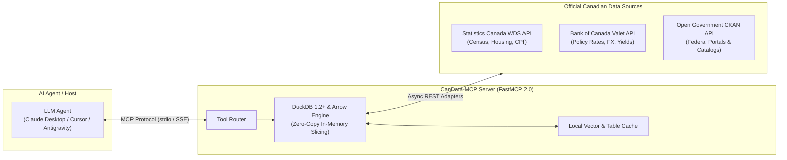

# Canadian Open Data Agentic Platform (CanData-MCP Server)

[](https://www.python.org/downloads/)
[](https://modelcontextprotocol.io/)
[](https://duckdb.org/)
[](https://langchain-ai.github.io/langgraph/)
[](https://github.com/neobenjax/Canadian-Open-Data-Agentic-Platform)

Official production distribution of the **Model Context Protocol (MCP)** server connecting LLM agents directly to official Canadian open data (**Statistics Canada**, **Bank of Canada**, and **Open Government Canada**).

---

> [!NOTE]
> ### 🏛️ Engineering Monorepo & Collaboration Hub
> This repository is the **standalone, distribution-ready MCP server package**.  
> For the complete engineering monorepo containing our team dynamics, meeting notes, agile sprint tracking, evaluation benchmarks, interactive 16:9 presentation slides, and team portfolio site, visit our main repository:  
> **👉 [Canadian-Open-Data-Agentic-Platform](https://github.com/neobenjax/Canadian-Open-Data-Agentic-Platform)**

---

## ⚡ Core Architecture

CanData-MCP provides high-performance data querying with zero-copy memory buffers, preventing LLM context window bloat and eliminating hallucinated statistical figures.



### Key Technical Pillars
- **Zero-Copy Memory Slicing:** Embeds **DuckDB 1.2+** with Apache Arrow streaming buffers to aggregate large federal datasets (e.g., 200MB census tables) into compact (<3KB) deterministic payloads before returning to the model.
- **FastMCP 2.0 Specification:** Employs MCP 2026 standards including tool annotations (`readOnly`, `idempotent`), runtime sampling, and progress notifications.
- **Stateful Multi-Agent Orchestration:** Optional `agent-orchestrator` suite built on **LangGraph 0.2+** with SQL verification, citation validation, and Human-in-the-Loop (`interrupt()`) boundary checkpoints.

---

## 🚀 Quickstart & Installation

### Option 1: Install with `uv` (Recommended)
```bash
# Clone the repository
git clone https://github.com/neobenjax/Canadian-Open-Data-Agentic-Platform-MCP-Server.git
cd Canadian-Open-Data-Agentic-Platform-MCP-Server

# Install with dependencies
uv pip install -e packages/candata-mcp
```

### Option 2: Run directly with `uvx`
```bash
uvx --from git+https://github.com/neobenjax/Canadian-Open-Data-Agentic-Platform-MCP-Server.git candata-mcp
```

---

## 🔌 Connecting to AI Hosts

### 1. Claude Desktop
Add to your `claude_desktop_config.json`:
```json
{
  "mcpServers": {
    "candata": {
      "command": "uv",
      "args": [
        "--directory",
        "/path/to/Canadian-Open-Data-Agentic-Platform-MCP-Server",
        "run",
        "candata-mcp"
      ],
      "env": {
        "PYTHONUNBUFFERED": "1"
      }
    }
  }
}
```

### 2. Cursor IDE (`.cursor/mcp.json`)
```json
{
  "mcpServers": {
    "candata": {
      "command": "uv",
      "args": ["run", "candata-mcp"],
      "cwd": "${workspaceFolder}"
    }
  }
}
```

### 3. Google Antigravity / AGY
Add to your Antigravity MCP server configuration in `~/.gemini/antigravity/mcp/candata-mcp.json`.

---

## 🛠️ MCP Tool Inventory

| Tool Name | Source | Description | Annotations |
| :--- | :--- | :--- | :--- |
| `statcan_query_table` | Statistics Canada | Queries StatCan WDS tables with DuckDB filtering and Arrow slicing. | `readOnly: true`, `idempotent: true` |
| `statcan_search_catalog` | Statistics Canada | Full-text semantic search for StatCan vector and table IDs. | `readOnly: true`, `idempotent: true` |
| `boc_get_valet_series` | Bank of Canada | Retrieves official daily/monthly policy interest rates, FX, and CPI series. | `readOnly: true`, `idempotent: true` |
| `boc_list_indicators` | Bank of Canada | Lists available core economic and financial market series from BoC Valet. | `readOnly: true`, `idempotent: true` |
| `open_canada_search` | Open Government | Queries datasets and CKAN records across Federal Government open data. | `readOnly: true`, `idempotent: true` |

---

## 👥 Core Team & Leadership

The Canadian Open Data Agentic Platform is engineered by a 3-person core collective:

- **[Benjamin Sanchez Zebadua](https://github.com/neobenjax)** — *Project Lead & Solutions Architect* (Architecture, FastMCP 2.0, DuckDB Engine, Monorepo Governance)
- **[Samir Ibrahim](https://www.linkedin.com/in/samiroibrahim/)** — *Co-Lead, Data Visualization & Agent Evals* (GTA Housing Benchmarks, Multi-Agent Reasoning, Plotly)
- **[Yassir Tagelsir Khougali](https://www.linkedin.com/in/yassir-tagelsir-khougali/)** — *Tech Delivery, PMO & HITL Transformation* (Human-in-the-Loop workflows, Linear tracking, Lineage Governance)

For complete biographies and architectural contributions, see [ABOUT_THE_TEAM.md](ABOUT_THE_TEAM.md).

---

## 🛡️ Developer Standards & Contributing

This package adheres to strict 2026 AI agent and developer guardrails:
- Review [.cursorrules](.cursorrules) for automated agent workflows.
- For issues, feature requests, or contributions to the core engine, please submit pull requests to the primary monorepo: [Canadian-Open-Data-Agentic-Platform](https://github.com/neobenjax/Canadian-Open-Data-Agentic-Platform).

---

## 📄 License

Licensed under the [Apache 2.0 License](LICENSE).
