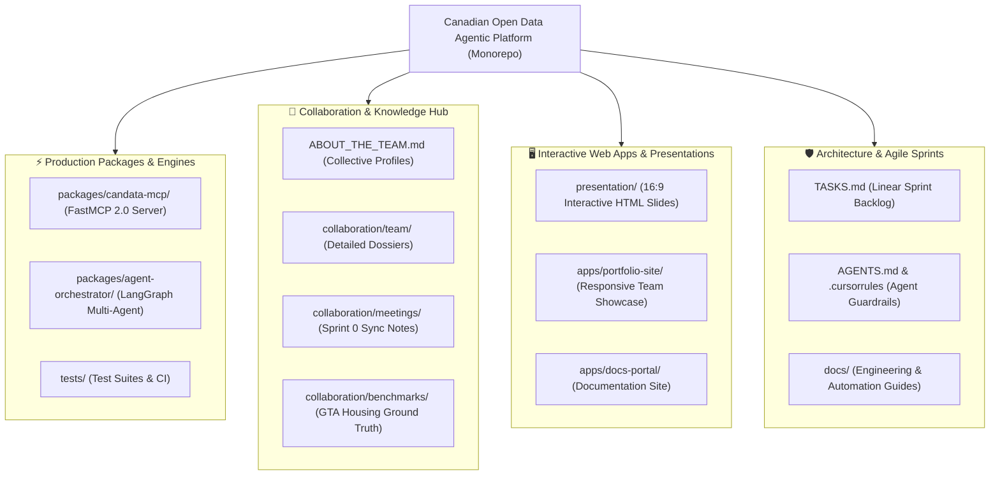

# Canadian Open Data Agentic Platform — Engineering Monorepo

Welcome to the **Canadian Open Data Agentic Platform** primary engineering monorepo and collaborative knowledge hub.

This repository serves as the **Single Source of Truth** for the core engineering team: containing the FastMCP 2.0 server codebase, LangGraph 0.2+ agent orchestrator, GTA housing evaluation benchmarks, team portfolio web applications, interactive 16:9 demo presentations, and agile sprint tracking.

---

> [!TIP]
> ### 🚀 Looking for the Standalone MCP Server?
> If you are an AI developer or external agent looking to install, configure, or use the **CanData-MCP** server in **Claude Desktop**, **Cursor IDE**, or **Google Antigravity**, visit our dedicated zero-bloat distribution repository:  
> **👉 [Canadian-Open-Data-Agentic-Platform-MCP-Server](https://github.com/neobenjax/Canadian-Open-Data-Agentic-Platform-MCP-Server)**

---

## 🧭 Monorepo Architecture & Directory Map

---

## 📚 Section Index

### 1. ⚡ Production Packages
- **[`packages/candata-mcp/`](packages/candata-mcp/):** Official FastMCP 2.0 server connecting LLMs to Statistics Canada, Bank of Canada, and Open Government Canada via server-side DuckDB 1.2+ Arrow vectorized memory buffers.
- **[`packages/agent-orchestrator/`](packages/agent-orchestrator/):** LangGraph 0.2+ stateful multi-agent system with SQL calculation nodes, citation validators, and Human-in-the-Loop (`interrupt()`) boundary checkpoints.
- **[`tests/`](tests/):** Pytest test suites and automated branch protection verification.

### 2. 👥 Team Dynamics & Collaboration
- **[`ABOUT_THE_TEAM.md`](ABOUT_THE_TEAM.md):** The core 3-person collective profile of Benjamin, Samir, and Yassir.
- **[`collaboration/team/benjamin_sanchez_profile.md`](collaboration/team/benjamin_sanchez_profile.md):** Benjamin's solutions architecture dossier.
- **[`collaboration/team-archive/martin_torres_profile.md`](collaboration/team-archive/martin_torres_profile.md):** Future phase contributor archive.
- **[`collaboration/meetings/sprint_0_trial_notes.md`](collaboration/meetings/sprint_0_trial_notes.md):** Weekly sync notes, onboarding trials, and team agreements.
- **[`collaboration/TASKS_3_PERSON_ALIGNMENT.md`](collaboration/TASKS_3_PERSON_ALIGNMENT.md):** Architectural boundaries and sprint responsibilities.

### 3. 📊 Ground-Truth Benchmarks
- **[`collaboration/benchmarks/benchmark_questions_draft.md`](collaboration/benchmarks/benchmark_questions_draft.md):** CMHC rent and StatCan income benchmark questions across 25 Greater Toronto Area municipalities to eliminate LLM hallucinations.
- **[`collaboration/tests/sandbox.md`](collaboration/tests/sandbox.md):** Sandbox trial entries and onboarding test logs.

### 4. 🖥️ Interactive Web Apps & Presentations
- **[`presentation/index.html`](presentation/index.html):** Zero-dependency, fixed 16:9 presentation deck built for weekly demos and stakeholder presentations.
- **[`apps/portfolio-site/index.html`](apps/portfolio-site/index.html):** Modern responsive web showcase displaying core team profiles, experience cards, and live project demos.
- **[`apps/docs-portal/`](apps/docs-portal/):** Dedicated documentation portal structure.

### 5. 🛡️ Architecture & Automation Guides
- **[`docs/DEVELOPER_SETUP_AND_AUTOMATION_GUIDE.md`](docs/DEVELOPER_SETUP_AND_AUTOMATION_GUIDE.md):** Guide to SSH commit signing, git automation, and Linear sync.
- **[`docs/CAN_08_ONBOARDING_AND_ENV_AUTOMATION.md`](docs/CAN_08_ONBOARDING_AND_ENV_AUTOMATION.md):** Zero-dependency `.env` wizard, Linear project hierarchy, and automated PR creation protocol.
- **[`docs/CAN_05_BRANCH_PROTECTION_AND_PEER_REVIEW_VERIFICATION.md`](docs/CAN_05_BRANCH_PROTECTION_AND_PEER_REVIEW_VERIFICATION.md):** Verification of triangular peer review loops (`Benjamin -> Samir -> Yassir -> Benjamin`).
- **[`CANADIAN_AGENTIC_DATA_PLATFORM_PLAN.md`](CANADIAN_AGENTIC_DATA_PLATFORM_PLAN.md):** Full multi-phase architectural roadmap.

---

## 🔄 Automated MCP Server Distribution

This monorepo automatically maintains the public standalone MCP server repository:

1. **Source of Truth:** All development on `candata-mcp` and `agent-orchestrator` takes place directly within this monorepo.
2. **Automated Publishing Workflow:** When changes merge into `main` touching `packages/**`, `tests/**`, or `MCP_README.md`, GitHub Actions (`.github/workflows/publish-mcp-server.yml`):
   - Extracts the original commit author (preserving your GitHub avatar, name, and profile link).
   - Publishes the updated MCP server package and maps `MCP_README.md` $\rightarrow$ `README.md` on the public [Canadian-Open-Data-Agentic-Platform-MCP-Server](https://github.com/neobenjax/Canadian-Open-Data-Agentic-Platform-MCP-Server) repository.
3. **Zero Bloat for End-Users:** Internal sprint logs, demo slides, and web apps stay safely inside this monorepo.

---

## 🤝 The Core Collective

- **[Benjamin Sanchez Zebadua](https://github.com/neobenjax)** — *Project Lead & Solutions Architect*
- **[Samir Ibrahim](https://www.linkedin.com/in/samiroibrahim/)** — *Co-Lead, Data Visualization & Agent Evals Lead*
- **[Yassir Tagelsir Khougali](https://www.linkedin.com/in/yassir-tagelsir-khougali/)** — *Technology Delivery & HITL Transformation Lead*

---

## 📄 License

Licensed under the [Apache 2.0 License](LICENSE).
