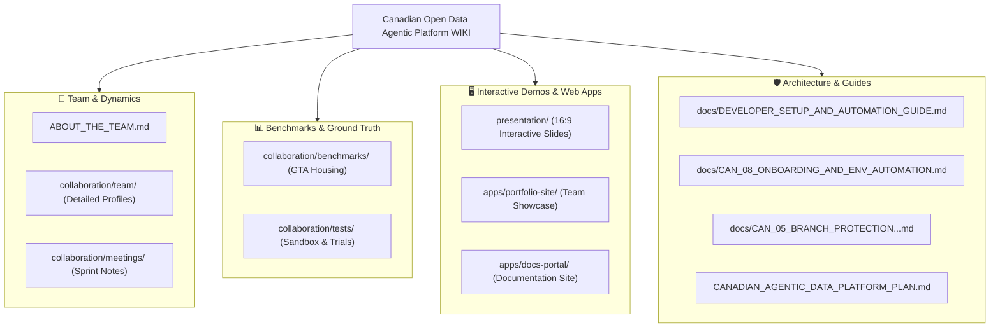

# Canadian Open Data Agentic Platform — Knowledge Base & WIKI

Welcome to the official **Documentation, Collaboration, and Knowledge Hub** for the **Canadian Open Data Agentic Platform**.

---

> [!IMPORTANT]
> ### ⚙️ Looking for the MCP Server & Source Code?
> To install the Model Context Protocol (MCP) server, connect it to AI hosts (Claude Desktop, Cursor, Antigravity), or inspect the Python codebase:  
> **👉 Visit the production codebase: [Canadian-Open-Data-Agentic-Platform](https://github.com/neobenjax/Canadian-Open-Data-Agentic-Platform)**

---

## 🧭 Knowledge Hub Directory

---

## 📚 Section Index

### 1. 👥 Team Dynamics & Collaboration
- **[Team Overview](ABOUT_THE_TEAM.md):** The 3-person collective profile of Benjamin, Samir, and Yassir.
- **[Benjamin Sanchez Zebadua — Solutions Architect Dossier](collaboration/team/benjamin_sanchez_profile.md):** Deep background in banking systems, FastMCP 2.0, DuckDB Arrow vectorized slicing, and Next.js.
- **[Martin Torres — Profile Archive](collaboration/team-archive/martin_torres_profile.md):** Preserved profile for future phases.
- **[Sprint 0 Trial & Meeting Notes](collaboration/meetings/sprint_0_trial_notes.md):** Weekly sync notes, onboarding trials, and team agreements.
- **[3-Person Alignment Notes](collaboration/TASKS_3_PERSON_ALIGNMENT.md):** Architectural boundaries and sprint responsibilities.

### 2. 📊 Ground-Truth Benchmarks & Agent Evaluation
- **[GTA Housing Ground-Truth Questions](collaboration/benchmarks/benchmark_questions_draft.md):** CMHC rent and StatCan income benchmark questions across 25 Greater Toronto Area municipalities to eliminate LLM hallucinations.
- **[Collaboration Sandbox](collaboration/tests/sandbox.md):** Sandbox trial entries and onboarding test logs.

### 3. 🖥️ Interactive Demos, Slides & Portfolio Sites
- **[Interactive 16:9 Presentation Slides](presentation/index.html):** Zero-dependency, fixed 16:9 presentation deck built for weekly demos and stakeholder presentations.
- **[Team Portfolio Site](apps/portfolio-site/index.html):** Modern responsive web showcase displaying core team profiles, experience cards, and live project demos.
- **[Documentation Portal](apps/docs-portal/):** Dedicated documentation portal structure.

### 4. 🛡️ Architecture, Governance & Automation Guides
- **[Developer Setup & Automation Guide](docs/DEVELOPER_SETUP_AND_AUTOMATION_GUIDE.md):** Complete guide to SSH commit signing, git automation, and Linear sync.
- **[CAN-08 Onboarding & Environment Automation](docs/CAN_08_ONBOARDING_AND_ENV_AUTOMATION.md):** Zero-dependency `.env` wizard, Linear project hierarchy, and automated PR creation protocol.
- **[CAN-05 Branch Protection & Peer Review Verification](docs/CAN_05_BRANCH_PROTECTION_AND_PEER_REVIEW_VERIFICATION.md):** Verification of triangular peer review loops (`Benjamin -> Samir -> Yassir -> Benjamin`).
- **[Linear & Agents Integration Guide](docs/LINEAR_AND_AGENTS_GUIDE.md):** AI agent standards across Claude Code, Cursor, and Antigravity.
- **[Canadian Agentic Data Platform Master Plan](CANADIAN_AGENTIC_DATA_PLATFORM_PLAN.md):** Full multi-phase architectural roadmap.
- **[General Plan & Vision Idea](General%20Plan%20-%20idea.md):** Original vision document.

---

## 🔄 Automated Continuous Sync Architecture

This WIKI repository operates on an automated continuous sync model:

1. **Single Source of Authoring:** Documentation, presentation slides, benchmarks, and portfolio assets are authored and updated within the main repository (`Canadian-Open-Data-Agentic-Platform`).
2. **Automated Mirroring:** When a Pull Request is approved and merged into `main` on the primary repository, a GitHub Actions workflow (`.github/workflows/sync-wiki.yml`) automatically synchronizes:
   - `collaboration/`
   - `docs/`
   - `presentation/`
   - `apps/`
   - `WIKI_README.md` (published as this repository's root `README.md`)
3. **Always Fresh:** The WIKI repository always reflects the latest state of documentation without requiring manual cross-repo commits.

---

## 🤝 The Core Collective

- **Benjamin Sanchez Zebadua** — *Solutions Architect & Lead*
- **Samir Ibrahim** — *Data Visualization & Agent Evals Lead*
- **Yassir Tagelsir Khougali** — *Technology Delivery & HITL Transformation Lead*
