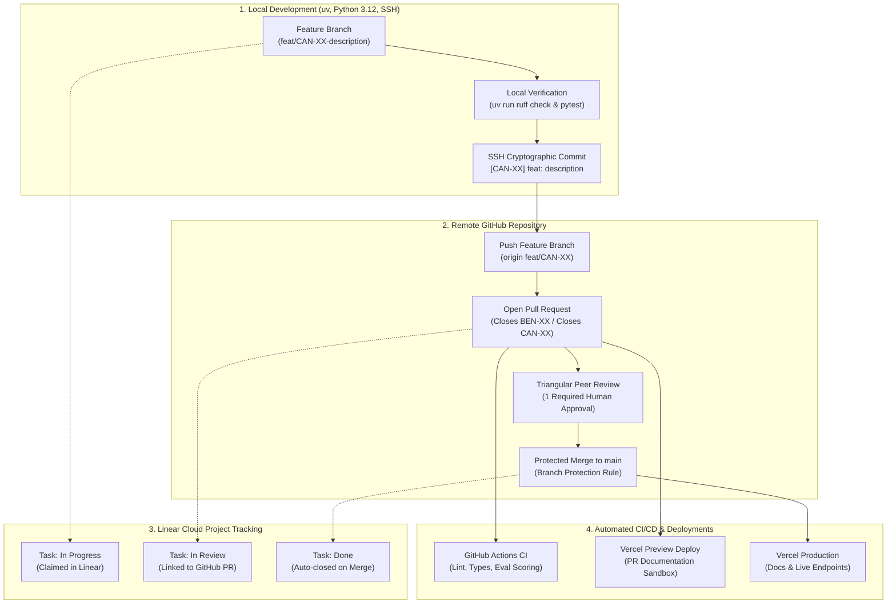

# Team Member Profile: Benjamin Sanchez Zebadua

**Role:** Project Lead & Solutions Architect  
**Location:** Ottawa, Ontario, Canada  
**Contact:** [benjaminsz.work@gmail.com](mailto:benjaminsz.work@gmail.com) · [benjaminsz.com](https://benjaminsz.com)  
**Profiles:** [LinkedIn](https://www.linkedin.com/in/benjaminsanchezzebadua/) · [GitHub (@neobenjax)](https://github.com/neobenjax)  

---

## 🧭 Executive Summary & Engineering Philosophy

Senior Full Stack Engineer and Solutions Architect with over a decade of hands-on experience building, scaling, and protecting high-volume web platforms and financial technology. 

My approach centers on **Spec-Driven Development (SDD)**: defining clear contracts, rigorous data boundaries, and reproducible systems before writing implementation code. In this project, I ensure our multi-agent architecture is fast, safe, auditable, and production-ready for Canadian open datasets.

---

## 🛠️ Career Highlights & Leadership

- **FinTech & Digital Banking at Scale (BBVA Mexico):**  
  Coordinated 3 agile teams through a major native-to-mobile infrastructure modernization, protecting continuous uptime for **20M+ active banking users**. Modernized legacy Java Spring and jQuery layers into modular, reusable web components, reducing UI issue turnaround from days to hours.
- **Frontend & Cloud Architecture (Stealth Docs Inc. & Consulting):**  
  Engineered custom data scraping pipelines and DNS routing, eliminating 100% of redirection errors. Architected containerized Docker developer workspaces, cutting onboarding setup time by 60% and eliminating environment drift.
- **Quality Gates & Governance:**  
  Established automated end-to-end testing suites (Mocha, Chai, Selenium) maintaining quality gates above 80%. Certified ScrumMaster (CSM) practicing clean git flows and measurable sprint cadences.
- **Domain & Education Credentials:**  
  - **AI Engineering:** Spec-Driven Development (SDD) & Agentic workflow enablement.
  - **FinTech & Regulatory Compliance:** Scaled compliance-sensitive banking workflows.
  - **Academic Background:** Postgraduate Diploma in Financial Planning & Wealth Management (Lambton College, Ottawa); B.Eng. in Information & Communication Technologies (Universidad de Tecamac); IFC® Certified (Investment Funds in Canada).

---

## 🏗️ Architecture Blueprint & 2026 Strategic Decisions

As Solutions Architect for the **Canadian Open Data Agentic Platform**, I am responsible for selecting and governing the core system architecture. Here is why each technology was chosen, what alternatives exist, and why our choice is the right asset for this project.

### 1. FastMCP 2.0 Core vs Traditional Custom REST / LangChain Tool Wrappers
- **The 2026 Reality:** The Model Context Protocol (MCP) by Anthropic has become the open standard for connecting AI agents to real-world data sources. FastMCP 2.0 brings typed Python server decorators, automatic JSON schema generation, and tool-level metadata (`readOnly`, `idempotent`).
- **Existing Alternatives:** Custom REST endpoints or ad-hoc LangChain tools.
- **Why FastMCP 2.0 Wins for CanData:** Custom tool scripts lack standardized client discovery and auth boundaries. FastMCP allows any compliant AI assistant (Claude Desktop, Cursor, Antigravity, or custom LangGraph nodes) to connect instantly without vendor lock-in.

### 2. DuckDB 1.2+ & Apache Arrow Streams vs In-Memory Pandas / Raw JSON
- **The 2026 Reality:** LLMs choke and waste expensive tokens when handed massive raw tables. Canadian statistical releases (like Statistics Canada WDS tables) can easily reach 100MB to 500MB of raw CSV/JSON.
- **Existing Alternatives:** Loading entire tables into Python Pandas DataFrames or serializing rows directly into LLM prompts.
- **Why DuckDB + Arrow Wins for CanData:** DuckDB runs directly in-process with zero network overhead. By streaming via Apache Arrow and executing exact SQL aggregations, we shrink 200MB public datasets to a precise, verifiable **<3KB** summary table before the LLM ever sees it. This eliminates hallucinated math and cuts token costs by 95%+.

### 3. Next.js 15 App Router & Fumadocs vs Legacy Static Site Generators
- **The 2026 Reality:** A modern AI developer platform needs dynamic search, interactive component playgrounds, and zero-stale documentation.
- **Existing Alternatives:** Static site generators (Docusaurus, MkDocs) or generic CMS pages.
- **Why Next.js 15 Wins for CanData:** Next.js 15 App Router with Tailwind CSS v4 and Fumadocs enables hybrid static/server-rendered documentation with built-in full-text search, live API exploration, and effortless deployment previews on Vercel.

### 4. Containerized Docker Workspaces vs Bare-Metal Local Environments
- **The 2026 Reality:** Multi-agent systems depend on exact native binaries (DuckDB C extensions, Python 3.12, UV package manager, Node engines). Local host inconsistencies waste developer hours.
- **Existing Alternatives:** Asking contributors to manually configure local system Python and environment variables.
- **Why Docker Wins for CanData:** Standardized, rootless Docker containers paired with `uv` give Benjamin, Samir, and Yassir identical, hardened runtime environments across Windows, macOS, and Linux.

---

## 🔄 End-to-End Delivery & Gitflow Architecture

Every code change, documentation update, and feature follows an automated, transparent pipeline across four integrated tiers:

### Protocol Highlights:
1. **Never Direct to `main`:** GitHub branch protection enforces feature branches and blocks direct pushes.
2. **Dual-Key Issue Tracking:** Every PR contains both `Closes BEN-XX` (Linear team key) and `Closes CAN-XXX` (project board key) for automatic status updates.
3. **Triangular Peer Review Loop:**
   - **Benjamin's PRs** $\rightarrow$ Reviewed and approved by **Samir Omer** (`@samiromer2`)
   - **Samir's PRs** $\rightarrow$ Reviewed and approved by **Yassir Khougali** (`@yassirtmk`)
   - **Yassir's PRs** $\rightarrow$ Reviewed and approved by **Benjamin Sanchez** (`@neobenjax`)
4. **Automated Verification:** `uv run ruff check .` and `uv run pytest` must pass cleanly before any code is merged.

---

## 🎯 Milestone Responsibilities Matrix

As Project Lead and Solutions Architect, my deliverables span the following roadmap milestones:

| Milestone | Key Tasks | Description |
| :--- | :--- | :--- |
| **Milestone 0: Sprint 0** | `CAN-00`, `CAN-01`, `CAN-05` | Onboarding trial, Gitflow verification, team architecture profiles. |
| **Milestone 1: Sprint 1** | `CAN-11`, `CAN-12`, `CAN-13`, `CAN-16` | Async StatCan/BoC HTTPX clients, FastMCP 2.0 core with DuckDB, API security audit. |
| **Milestone 2: Sprint 2** | `CAN-21`, `CAN-23`, `CAN-25` | Typed `AgentState` schemas, DuckDB SQL Data Analyst node, OpenTelemetry tracing. |
| **Milestone 3: Sprint 3** | `CAN-31`, `CAN-33`, `CAN-34` | Next.js 15 App Router docs portal, LangGraph `interrupt()` breakpoints, CKAN open data connector. |
| **Milestone 4: Sprint 4** | `CAN-42`, `CAN-44`, `CAN-45` | GitHub Actions CI evaluation pipeline, prompt caching optimization, hardened Docker images. |
| **Milestone 5: Sprint 5** | `CAN-51`, `CAN-52`, `CAN-53`, `CAN-54` | PyPI packaging (`candata-mcp`), Anthropic MCP registry submission, Vercel deployment, bilingual README. |
| **Milestone 6: Sprint 6** | `CAN-61`, `CAN-62`, `CAN-63`, `CAN-64` | Portfolio showcase launch, technical interview assets, employer outreach. |
