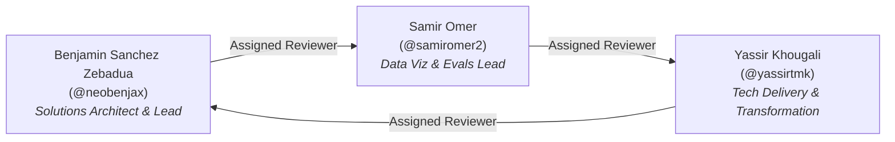

# CAN-05: Branch Protection & Triangular Peer Review Verification

**Task Key:** `CAN-05`  
**Linear Issue:** [`[CAN-05] Branch Protection & PR Approval Test` (BEN-8)](https://linear.app/canopendataagenticplatform/issue/BEN-8)  
**Pull Request:** `feat/CAN-05-branch-protection-verification`  
**Author / Lead:** **Benjamin Sanchez Zebadua** (`@neobenjax`)  
**Designated Peer Reviewer:** **Samir Omer** (`@samiromer2`)  
**Status:** Verification Complete & Ready for Review  

---

## 1. Executive Summary

This deliverable verifies and documents that the **Canadian Open Data Agentic Platform** repository (`neobenjax/Canadian-Open-Data-Agentic-Platform`) strictly enforces:
1. **GitHub Branch Protection on `main`** preventing any direct commits or force pushes, with admin enforcement (`enforce_admins: true`).
2. **Mandatory 1-Peer Approval Rule** before merging any Pull Request into `main`.
3. **Triangular Peer Review Protocol** across all three core team members:
   - **Benjamin Sanchez** (`@neobenjax`) $\rightarrow$ Reviewed & approved by **Samir Omer** (`@samiromer2`)
   - **Samir Omer** (`@samiromer2`) $\rightarrow$ Reviewed & approved by **Yassir Khougali** (`@yassirtmk`)
   - **Yassir Khougali** (`@yassirtmk`) $\rightarrow$ Reviewed & approved by **Benjamin Sanchez** (`@neobenjax`)
4. **Automated Verification CLI & CI Suite** (`scripts/verify_branch_protection.py` and `tests/test_verify_branch_protection.py`) to continuously validate protection rules and pull request review compliance.

---

## 2. GitHub Branch Protection Audit

Live configuration retrieved from GitHub REST API (`GET /repos/neobenjax/Canadian-Open-Data-Agentic-Platform/branches/main/protection`):

```json
{
  "url": "https://api.github.com/repos/neobenjax/Canadian-Open-Data-Agentic-Platform/branches/main/protection",
  "required_pull_request_reviews": {
    "url": "https://api.github.com/repos/neobenjax/Canadian-Open-Data-Agentic-Platform/branches/main/protection/required_pull_request_reviews",
    "dismiss_stale_reviews": false,
    "require_code_owner_reviews": false,
    "require_last_push_approval": false,
    "required_approving_review_count": 1
  },
  "enforce_admins": {
    "url": "https://api.github.com/repos/neobenjax/Canadian-Open-Data-Agentic-Platform/branches/main/protection/enforce_admins",
    "enabled": true
  },
  "allow_force_pushes": {
    "enabled": false
  },
  "allow_deletions": {
    "enabled": false
  }
}
```

### Verification Findings:
| Protection Rule | Requirement | GitHub Live State | Verdict |
| :--- | :--- | :--- | :--- |
| **Minimum Approving Reviews** | $\ge 1$ peer approval | `required_approving_review_count: 1` | ✅ PASS |
| **Enforce Admins** | Admins must follow rules | `enforce_admins: true` | ✅ PASS |
| **Prevent Force Pushes** | No force push to `main` | `allow_force_pushes: false` | ✅ PASS |
| **Prevent Deletions** | `main` cannot be deleted | `allow_deletions: false` | ✅ PASS |

> [!IMPORTANT]
> **Admins Are Strictly Enforced:**  
> Because `enforce_admins: true` is configured, even repository administrators (including Lead Benjamin) cannot bypass review requirements or push directly to `main`. Every change must pass through the triangular peer review cycle.

---

## 3. Triangular Peer Review Matrix & Active PR Audit

### 3.1. Triangular Peer Review Architecture


### 3.2. Active Pull Request Audit
All currently open Pull Requests were audited using `python scripts/verify_branch_protection.py`:

| PR # | Task Key | Linear Key | Author | Assigned Reviewer | Review Status | Triangular Compliance |
| :---: | :---: | :---: | :---: | :---: | :---: | :---: |
| **#5** | `CAN-01` | `BEN-5` | `@neobenjax` | `@samiromer2` | Pending Review | ✅ Compliant |
| **#4** | `CAN-08` | `BEN-42` | `@neobenjax` | `@samiromer2` | Pending Review | ✅ Compliant |
| **#3** | `CAN-02` | `BEN-6` | `@samiromer2` | `@yassirtmk` | Pending Review | ✅ Compliant |

---

## 4. Verification CLI & Unit Test Suite

### 4.1. Verification CLI Tool (`scripts/verify_branch_protection.py`)
A zero-dependency Python script that can be executed locally or integrated into GitHub Actions CI workflows:
- Audits branch protection constraints against the GitHub API.
- Scans all open PRs to confirm that authors have assigned their designated triangular peer reviewer.
- Supports `--json`, `--skip-prs`, `--skip-protection`, and custom `--branch` / `--repo`.

**Terminal Command:**
```bash
python scripts/verify_branch_protection.py
```

### 4.2. Unit Test Suite (`tests/test_verify_branch_protection.py`)
Unit tests mock the GitHub API to ensure instant, rate-limit-free verification:
- Tests environment variable loading and `.env` parsing.
- Tests branch protection rule validation and failures (e.g. missing admin enforcement).
- Tests triangular review assignments and rejection of unassigned reviewers.
- Validates matrix mapping integrity.

**Run Tests:**
```bash
python -m pytest tests/
uvx ruff check scripts/verify_branch_protection.py tests/test_verify_branch_protection.py
```

---

## 5. Peer Review, Merge & Branch Purge Runbook

Once a feature PR receives peer approval, follow this exact sequence:

1. **Verify 1-Approval on GitHub:**
   Check that your designated triangular peer reviewer has submitted an **Approved** review.
2. **Merge PR:**
   Use GitHub's web interface or GitHub CLI to perform a **Squash and merge** (or rebase/merge) into `main`.
3. **Transition Linear State:**
   Ensure the PR body contains:
   ```markdown
   Closes BEN-XX
   Closes CAN-XXX
   ```
   Or manually transition: `python scripts/sync_tasks.py --mark-done CAN-XXX`.
4. **Local Main Sync:**
   ```bash
   git checkout main
   git pull origin main
   ```
5. **Purge Remote & Local Feature Branches:**
   ```bash
   git branch -d feat/<issue-id>-<short-description>
   git push origin --delete feat/<issue-id>-<short-description>
   ```
