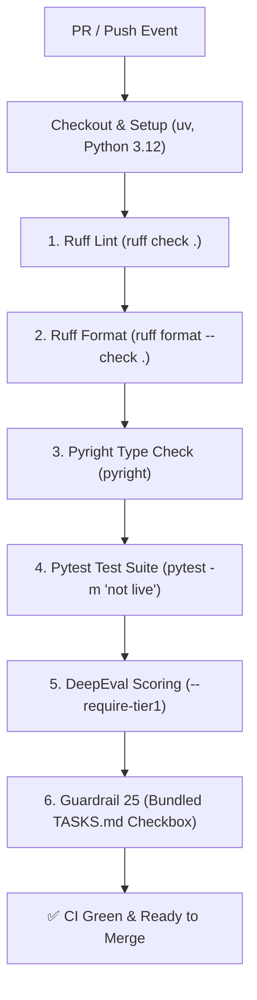

# CAN-42: CI Pipeline with DeepEval Two-Tier Automated Scoring Gate

## Overview

CAN-42 configures the automated GitHub Actions Continuous Integration (CI) pipeline (`.github/workflows/ci.yml`) to enforce code quality, static type safety, regression testing, and deterministic evaluation scoring on every pull request and push to `main`.

The CI pipeline runs 100% offline without requiring network access or external LLM API tokens.

---

## Architecture & Verification Sequence

The `verify` job in `.github/workflows/ci.yml` executes the following sequence:



### Steps in Detail

1. **Ruff Linter (`uv run ruff check .`):** Enforces PEP 8 standards, import order (`I`), upgrade rules (`UP`), and bug patterns (`B`) with a 100-character line length limit.
2. **Ruff Formatter (`uv run ruff format --check .`):** Guarantees uniform formatting across the repository.
3. **Pyright Type Checker (`uv run pyright`):** Strict static typing across `packages/candata-mcp` and `packages/agent-orchestrator`.
4. **Pytest Suite (`uv run pytest -m 'not live'`):** Executes 380+ unit and integration tests across data connectors, DuckDB engine, LangGraph supervisor, and evals.
5. **DeepEval Automated Scoring (`collaboration/benchmarks/run_agent_evals.py grade`):**
   - Evaluates recorded benchmark runs against `collaboration/benchmarks/gta_ground_truth_v1.json`.
   - **Tier 1 (Core Citations):** Strict pass/fail gate (`--require-tier1`). Every ground-truth tuple `(table_id, vector_id, reference_period)` must be cited; any extra or missing citation fails the build.
   - **Tier 2 (Enrichment & Freshness):** Verifies bilingual titles, publisher metadata, coordinate structure, and revision timestamps.
6. **Guardrail 25 Checkbox Verification (`scripts/verify_pr_ready.py`):**
   - Validates that the active PR branch bundles its completion checkbox (`- [x]`) inside `TASKS.md`, preventing untracked PR merges.

---

## Zero-Cost, Zero-Token Offline CI Gate

The DeepEval grading harness uses deterministic `BaseMetric` subclasses rather than LLM judges:

- **No API Tokens:** CI does not require or store an `ANTHROPIC_API_KEY`, eliminating credential exposure risks and continuous cloud billing.
- **Hermetic & Fast:** Grading runs in under 0.05 seconds against committed JSONL runs (`collaboration/benchmarks/agent_evals/runs/`).
- **Strict Exit Code:** The `--require-tier1` flag causes the script to exit with code `1` if any question fails Tier 1, failing the GitHub Action.

---

## Local Pre-Flight Verification

Developers can execute the complete CI verification suite locally using `scripts/verify.py`:

```bash
# Run all 5 checks (Ruff check, Ruff format, Pyright, Pytest, DeepEval)
python scripts/verify.py

# Fast static analysis only (skips Pytest and DeepEval)
python scripts/verify.py --fast

# Auto-fix linting and formatting issues
python scripts/verify.py --fix
```

### Manual DeepEval Run & Grading

```bash
# Grade the committed benchmark run offline
uv run python collaboration/benchmarks/run_agent_evals.py grade collaboration/benchmarks/agent_evals/runs/agent_demo_live_20261104.jsonl --require-tier1

# (Optional) Run live evaluation questions locally with personal API key
uv run python collaboration/benchmarks/run_agent_evals.py run --only GT-05 GT-12 GT-13
```
